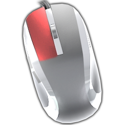
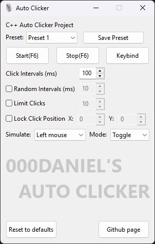

# AUTO CLICKER
 <br />
Auto Clicker - a simple GUI program that allows the user to automatically simulate mouse clicks with a variety of different options. <br />
   🞄 Supports random click intervals <br />
   🞄 Supports limiting number of clicks <br />
   🞄 Supports locking clicks to a position on screen <br />
   🞄 Supports multiple settings presets <br />
   🞄 Supports toggle or hold modes <br />
<br />
### [Download Link](https://github.com/000Daniel/CPP-Projects/releases/tag/AutoClicker1.0.1)

<br />
<br />
<br />
### Change Log - 1.0.1.0 (3.11.2026)
   🞄 Added 3 presets, now you can switch between them as you need - all settings are saved to each preset. <br />
   🞄 Added a toggle/hold button, to switch between auto clicking modes. <br />
   🞄 Added key bind support for Mouse4 and Mouse5 keys. <br />
   🞄 Added a save button as well as more auto save features. <br />
   🞄 Fixed a crashing issue when stopping the auto clicker. <br />
   🞄 Fixed an issue where auto clicker would continue to click when selecting a key bind. <br />
   🞄 Fixed an issue where using high click intervals would cause the program to freeze and not respond properly. <br />
   🞄 Changed the internal code to use mouse and keyboard hooks (win32). <br />
<br />
<br />
<br />
This is my first program made with C++! <br />
Remember that this project was an exercise so issues are to be expected. <br />
The project utilizes [wxWidgets](https://wxwidgets.org/) for its functionality. <br />
<br />
### EXTRA:
   🞄 GCC vesrion: 6.3.0 <br />
   🞄 wxWidgets version: 3.3.1 <br />
   🞄 Visual Studio Community 2026 version: 18.11.00 <br />
   🞄 [Source-Code documentation](https://github.com/000Daniel/CPP-Projects/blob/main/AutoClicker/Documentation.md) <br />
   🞄 Used ChatGPT's suggestions for some feature implementation.
<br />
<br />
<br />
```diff
- created by https://github.com/000Daniel
```
Began development on: 15.10.2025 <br />
Publish date: 25.10.2025 <br />
